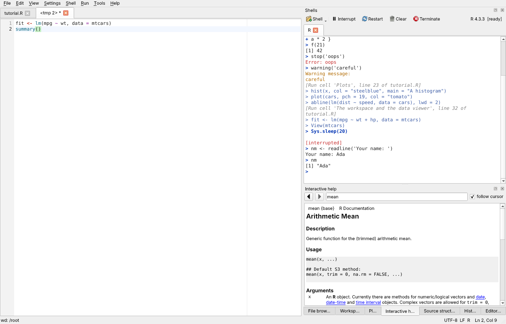

# Ryzo — the interactive editor for R

Ryzo is an R version of [Pyzo](https://github.com/pyzo/pyzo), the interactive
editor for Python. It has the same layout and way of working: an editor with
**cells**, one or more **interactive R shells** next to it, and a set of small
tools. It runs on Windows, macOS and Linux, and uses your existing R installation.



## Install and run

You need **R** (https://cran.r-project.org) and **Python 3.9+**.

```bash
pip install .
```

```bash
ryzo
```

To run from a source checkout without installing it:

```bash
pip install PySide6
```

```bash
python ryzolauncher.py
```

Ryzo finds R on your `PATH` and in common install locations. To use another R
installation, open **Shell > Edit shell configurations**.

## Features

| Area | What you get |
|---|---|
| Editor | R syntax highlighting (including raw strings, pipes and roxygen), line numbers, indentation guides, brace matching, smart indentation, auto-closing brackets, comment and uncomment, find and replace with regular expressions, a long-line marker, zoom, and light and dark themes |
| Cells | Lines starting with `##`, `# %%`, or RStudio-style `# Section ----` start a cell. Run a cell with **Ctrl+Enter** |
| Shells | Several R sessions in tabs, with interrupt, restart and terminate. You get continuation prompts (`+`), history search with Up/Down, Tab completion, and `readline()`/`scan()` support. Errors and warnings are formatted the way R prints them |
| Completion | As you type, from the live R session (objects, `df$col`, `pkg::fun`, arguments) plus words in the open file |
| Calltips | Type `(` after a function name to see its arguments |
| Plots | Graphics are redrawn to fit the panel exactly (sharp on high-DPI screens) and re-fit when you resize it. Thumbnail strip and history, zoom and pan (Ctrl+wheel, drag, double-click for 1:1), copy to clipboard, a separate resizable plot window, and export to PNG, PDF, SVG, JPEG or TIFF at any size and DPI (with presets for slides and journals). An optional modern style for base graphics. `plot()` followed by `abline()` updates the same plot |
| Workspace | Lists objects in the global environment with their class, size and a preview. Double-click a list, data frame or environment to look inside |
| Data viewer | `View(df)` opens a sortable, filterable table |
| Interactive help | `?topic` shows R's HTML documentation in the Help tool, with working links. The tool can also follow the editor cursor |
| Source structure | Lists the cells, functions, R6/S4 classes and `library()` calls in the current file |
| File browser | Starred folders, a filter, and right-click actions: source a file, import a CSV, load `.rds`/`.RData`, set the working directory |
| History, editor list | As in Pyzo |
| Session | Open files, cursor positions, window layout and shell history are restored on the next start |

## Keyboard shortcuts (the same as Pyzo where possible)

| Action | Shortcut |
|---|---|
| Run selection / current line | Alt+Enter, F9 |
| Run selection and advance | Shift+F9, Shift+Alt+Enter |
| Run cell | Ctrl+Enter |
| Run cell and advance | Ctrl+Shift+Enter |
| Run file | Ctrl+E, F5 |
| Run file as script (restart R, change to the file's folder, run) | Ctrl+Shift+E, Ctrl+F5 |
| Run main file / as script | Ctrl+M, F6 / Ctrl+Shift+M, Ctrl+F6 |
| Interrupt | Ctrl+I (or Ctrl+C in the shell with nothing selected) |
| Restart shell / close shell | Ctrl+K / Alt+K |
| New shell from configuration 1–8 | Ctrl+1 … Ctrl+8 |
| Clear shell | Ctrl+L |
| Focus editor / shell | Ctrl+9, F2 / Ctrl+0, F1 |
| Comment / uncomment / toggle | Ctrl+R / Ctrl+T / Ctrl+Shift+3, Ctrl+/ |
| Find / replace / next / previous | Ctrl+F / Ctrl+H / Ctrl+G, F3 / Ctrl+Shift+G, Shift+F3 |
| Duplicate line / delete line | Ctrl+Shift+D / Ctrl+Shift+K |
| Help on word under cursor | Shift+F1 |
| Zoom | Ctrl+= / Ctrl+- / Ctrl+\ |

## How it works

Each shell starts its own interactive R process (`R --interactive --no-readline`)
and loads `ryzo/kernel/ryzo_kernel.R` into it. That kernel uses only base R, so
you don't need to install any R packages.

- The IDE sends requests (evaluate code, complete, calltip, workspace, help,
  plot size) over a **local TCP socket**, protected by a random token.
- R replies with **framed JSON messages on stdout**, mixed in with ordinary
  output, so output and status messages arrive in the right order.
- **stdin is left alone**, so `readline()`, `scan()` and `menu()` work in the shell.
- Evaluation copies R's top-level REPL: each expression goes through
  `withVisible()`, and the shell receives errors, warnings and messages.
  `traceback()`, `warnings()` and `.Last.value` behave as they do in plain R.
- Plots are drawn on an invisible `pdf(NULL)` device with the display list
  turned on. After each command, and before a new page starts, the page is
  replayed into a PNG for the Plots tool.
- `?`/`help()`, `View()` and `browseURL()` are redirected to Ryzo's tools.
  These overrides live in the `tools:ryzo` environment on the search path, so
  your global environment stays clean.

## Differences from Pyzo

- There is no step-through debugger yet. `browser()` works in a basic way
  through the shell's stdin, but Pyzo's breakpoints and debug toolbar aren't
  there.
- Interrupting R on **Windows** isn't supported, because R can't receive a
  SIGINT there. Use Restart instead.
- Pyzo's "Logger" tool (a Python shell into the IDE itself) is replaced by the
  **Plots** tool, which matters more for R work.

## Building the Windows exe

On Windows, with Python 3.12:

```bash
pip install pyinstaller "PySide6-Essentials==6.6.3.1"
```

```bash
pyinstaller packaging/ryzo.spec
```

This produces a single-file `dist/Ryzo.exe`. R itself is not bundled: Ryzo uses
the R installed on the computer, and finds it in `C:\Program Files\R`
automatically.

## Development

```bash
pip install -e ".[test]"
```

```bash
pytest tests
```

Configuration is stored in `~/.config/ryzo/config.json` on Linux,
`~/Library/Application Support/ryzo` on macOS, and `%APPDATA%\ryzo` on Windows.
Set `RYZO_CONFIG_DIR` to use a different folder.

License: BSD 2-clause, the same as Pyzo.
